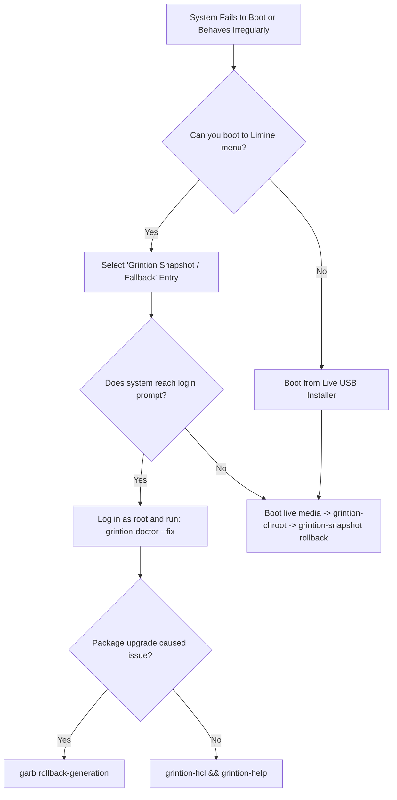

# Grintion-OS Official User Handbook

Welcome to the comprehensive handbook for **Grintion-OS**, an independent, security-hardened Linux distribution engineered for predictability, transparency, and high performance without systemd.

---

## Table of Contents
1. [Core Philosophy & Architecture](#1-core-philosophy--architecture)
2. [Installation Guide](#2-installation-guide)
3. [Package Management with `garb`](#3-package-management-with-garb)
4. [Service Supervision with Runit](#4-service-supervision-with-runit)
5. [System Configuration (`grintion-config`)](#5-system-configuration-grintion-config)
6. [Networking, Roaming & Privacy](#6-networking-roaming--privacy)
7. [Desktop Environments & Wayland](#7-desktop-environments--wayland)
8. [Boot Security & TPM Attestation](#8-boot-security--tpm-attestation)
9. [Security Hardening & Profiles](#9-security-hardening--profiles)
10. [Disaster Recovery Decision Tree & FAQ](#10-disaster-recovery-decision-tree--faq)

---

## 1. Core Philosophy & Architecture

- **Predictable Init**: Grintion-OS uses `runit` for process supervision. Stage 1 executes core initialization, Stage 2 supervises daemons via symlinks in `/var/service`, and Stage 3 coordinates graceful shutdown.
- **Independence**: Native package formats (`.garb`), signed repository streams (`grintion-channel`), and atomic rollback generations.
- **Hardware Honesty**: The system does not claim support for hardware or security features (Secure Boot, LUKS, Bare-Metal) without concrete, recorded automated tests.

---

## 2. Installation Guide

Grintion-OS installs from a unified hybrid ISO supporting both UEFI and BIOS systems.

### Quick Unattended Installation
```bash
grintion-install --disk /dev/nvme0n1 --user grintion --desktop xfce --security-profile workstation
```

### Full Disk Encryption (LUKS2)
```bash
grintion-install --disk /dev/nvme0n1 --encrypt --user grintion --filesystem btrfs
```

### Guided Interactive TUI
Run `grintion-install --tui` to step through the guided partitioner, filesystem selector (ext4, btrfs, xfs, f2fs), desktop profile choice, and security profile selection.

---

## 3. Package Management with `garb`

`garb` provides transactional, generation-tracked software management. On a
fresh install the first `install`, `search`, `info` or `upgrade` syncs missing
pacman databases automatically; package names such as `NetworkManager` and
`kde-plasma` are normalized before delegation.

- **Search and Info**:
  ```bash
  garb search neovim
  garb info neovim
  ```
- **Install and Upgrade**:
  ```bash
  sudo garb install neovim git
  sudo garb upgrade
  ```
- **Rollback Generations**:
  Every upgrade creates a timestamped generation snapshot.
  ```bash
  garb generations
  garb rollback-generation 3
  ```
- **Package Pinning and Holds**:
  ```bash
  garb hold linux-hardened
  garb pin glibc 2.38-1
  ```
- **Mirror Optimization**:
  ```bash
  garb mirror-rank
  ```

---

## 4. Service Supervision with Runit

Services reside in `/etc/sv/` and are enabled by symlinking into `/var/service/`:
```bash
# Enable and start a service
ln -s /etc/sv/bluetoothd /var/service/

# Check status of all services
sv status /var/service/*

# Stop or restart a service
sv down bluetoothd
sv restart bluetoothd
```

### Watchdog Protection
The `grintion-watchdog` service continuously monitors supervised daemons, automatically restarting failed processes while enforcing exponential backoff limits to prevent restart loops.

---

## 5. System Configuration (`grintion-config`)

Launch the unified configuration tool via `grintion-config` or use command-line options:
- **Set Timezone**: `grintion-config --set-timezone UTC`
- **Set Hostname**: `grintion-config --set-hostname workstation`
- **Power Governors**: `grintion-power set-governor performance`
- **Thermal Profiles**: `grintion-power set-profile balanced`

---

## 6. Networking, Roaming & Privacy

The base image's network stack is orchestrated via `grintion-network`. A
graphical profile switches to NetworkManager automatically, so desktop applets
use `sv status /var/service/NetworkManager` and `nmcli`, not systemctl:
- **Scan & Connect Wi-Fi**:
  ```bash
  grintion-network scan
  grintion-network connect MySSID
  ```
- **Enterprise WPA2/WPA3**:
  ```bash
  grintion-network connect-enterprise CampusWiFi --identity user@univ.edu
  ```
- **MAC Address Randomization**:
  ```bash
  grintion-network set-mac-randomization on
  ```
- **DNS Leak Testing**:
  ```bash
  grintion-network dns-leak-test
  ```

---

## 7. Desktop Environments & Wayland

Grintion-OS supports both Wayland and X11 without requiring systemd-logind.
- **Seat Management**: Handled via `seatd` and `grintion-session`.
- **Display Managers**: SDDM (Wayland), LightDM (X11), and greetd are supported with pre-configured PAM stacks. GDM is not used because it requires systemd-logind.
- **Desktop Profiles**: XFCE, i3, KDE Plasma, LXQt and Sway render in QEMU/KVM. GNOME is refused because `gnome-session` requires the systemd user session manager.
  ```bash
  grintion-desktop list
  grintion-desktop install sway
  ```

---

## 8. Boot Security & TPM Attestation

- **Secure Boot & MOK**: Generate and enroll local machine keys using `grintion-secureboot`.
- **Unified Kernel Images (UKI)**: Assemble monolithic PE/COFF kernels containing early microcode, initramfs, and cmdline with `grintion-uki`.
- **TPM 2.0 Attestation**: Inspect PCR values and verify firmware integrity:
  ```bash
  grintion-attest snapshot
  grintion-attest verify
  ```
- **TPM-Backed Disk Encryption**:
  ```bash
  grintion-tpm-luks seal /dev/nvme0n1p2
  ```

---

## 9. Security Hardening & Profiles

Grintion-OS provides four switchable security profiles via `grintion-security`:
- **`workstation`**: Default interactive profile with inbound firewall drop and shipped daemon AppArmor enforcement.
- **`server`**: Hardened server profile with USB data-block mode and strict inbound firewall rules. The base image ships and enables the auditd daemon with focused rules.
- **`kiosk`**: Locked-down single-application mode with USB data-blocking and restricted inbound traffic.
- **`air-gapped`**: Offline profile with all network traffic dropped.

`grintion-security set <profile>` applies the firewall, AppArmor and USB policy
before writing profile state and verifies the running result. Use
`--config-only` only when staging an image without booting it; that flag does
not activate any control.

### Application Sandboxing
Run untrusted software in an isolated Bubblewrap container:
```bash
grintion-sandbox --no-net firefox
```

### File Integrity Monitoring
```bash
grintion-integrity init
grintion-integrity check
```

---

## 10. Disaster Recovery Decision Tree & FAQ



### Frequently Asked Questions (FAQ)

**Q: Why does Grintion-OS not use systemd?**
A: To provide architectural clarity, minimal resource consumption, deterministic initialization, and transparent process supervision through runit.

**Q: Where can I look up system error codes?**
A: Run `grintion-help <CODE>` (e.g., `grintion-help E-BOOT-001`) or `grintion-help --list`.

**Q: How do I generate a bug-report bundle?**
A: Run `grintion-report`. It sanitizes IP addresses, passwords, and sensitive keys into an encrypted or compressed diagnostic bundle ready for issue tracking.

